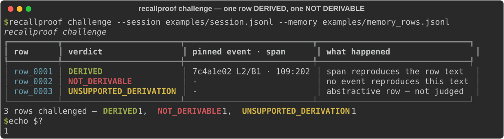

[English](./README.md) | **简体中文**

<p align="center">
  <a href="https://github.com/SuperMarioYL/recallproof"></a>
</p>

<p align="center">
  <picture>
    <source media="(prefers-color-scheme: dark)" srcset="./assets/hero-dark.svg">
    <source media="(prefers-color-scheme: light)" srcset="./assets/hero-light.svg">
    
  </picture>
</p>

<p align="center">
  <a href="https://github.com/SuperMarioYL/recallproof/actions/workflows/ci.yml"></a>
  <a href="./LICENSE"></a>
  
  
  
</p>

<h1 align="center">RecallProof</h1>

<p align="center"><b>面向 AI Agent 记忆的召回取证：把每一条被召回的记录重导出到它来源的那条会话事件。</b></p>

三个 LLM 裁判分不出「真实的 Agent 记忆」和「伪造的记忆」。RecallProof 给每一条记忆行加一个可重放的指针，指向它来源的事件；这样你可以对一条可疑的召回发起质询，拿到一个可机器校验的判定，而不是再要一份「意见」。

```console
$ recallproof challenge --session examples/session.jsonl --memory examples/memory_rows.jsonl
┏━━━━━━━━━━┳━━━━━━━━━━━━━━━━━━━━━━━━┳━━━━━━━━━━━━━━━━━━━━━━━━━━┳━━━━━━━━━━━━━━━━━━━━━━━━━━━━━━━┓
┃ row      ┃ verdict                ┃ pinned event · span      ┃ what happened                 ┃
┡━━━━━━━━━━╇━━━━━━━━━━━━━━━━━━━━━━━━╇━━━━━━━━━━━━━━━━━━━━━━━━━━╇━━━━━━━━━━━━━━━━━━━━━━━━━━━━━━━┩
│ row_0001 │ DERIVED                │ 7c4a1e02 L2/B1 · 109:202 │ span reproduces the row text  │
│ row_0002 │ NOT_DERIVABLE          │ -                        │ no event reproduces this text │
│ row_0003 │ UNSUPPORTED_DERIVATION │ -                        │ abstractive row — not judged  │
└──────────┴────────────────────────┴──────────────────────────┴───────────────────────────────┘
3 rows challenged — DERIVED 1, NOT_DERIVABLE 1, UNSUPPORTED_DERIVATION 1
```

`row_0001` 从 transcript 第 2 行的第 109 到 202 个字符重导出成功。`row_0002` 声称是那次会话里的一个决定，而没有任何事件能复现它——这正是今天没有任何裁判、也没有我们调研过的任何记忆系统能标出来的那一行。`row_0003` 是 AI 压缩出来的摘要，所以工具拒绝给它打分。

**只读。没有配置文件，没有 API Key，不调模型，不向任何记忆存储写入。**

---

## 目录

- [为什么需要它](#为什么需要它)
- [它是怎么工作的](#它是怎么工作的)
- [安装](#安装)
- [快速开始](#快速开始)
- [演示](#演示)
- [用法](#用法)
- [能力边界](#能力边界)
- [配置](#配置)
- [路线图](#路线图)
- [许可证](#许可证)

---

## 为什么需要它

Agent 记忆已经是「承重结构」了。一条被召回的记录——「我们决定用 Postgres」、「那次故障是 token 过期」——越来越常被当作归因依据：写进复盘、写进事故报告、写进「我们当时决定用 X」的变更说明。但这条记录里没有任何东西记录它是真的从会话事件里抽出来的，还是写它的那个模型编出来的。

目前唯一被尝试过的检查手段是 LLM 裁判，而[唯一一份公开的尝试](https://kairos-experiment.com/checks.html)是失败的：三个裁判，无法区分真实记忆和伪造记忆。这是结构性问题，不是调参问题。裁判读到的，是记忆系统自己产出的那段无锚文本，所以它只能对第一个模型表示同意或不同意，永远无法证明某一行来自某个事件。

缺的是一个可机器校验的信号。而一行记忆能给出的诚实答案只有三种：

| 判定 | 含义 | 如何算出 |
| --- | --- | --- |
| `DERIVED` | 这一行就是某个会话事件的字节级切片。 | 重读被钉住的那一行，切出被钉住的字符区间，逐字节比较。 |
| `NOT_DERIVABLE` | 这一行声称来自该会话，但没有任何事件能复现它。 | 同一次重放失败：找不到匹配事件、该行在钉住之后被改过、或区间已经切不出原文。 |
| `UNSUPPORTED_DERIVATION` | 这一行不是任何事件的切片（AI 压缩摘要、embedding、多事件合并），或它唯一的证据落在此工具不索引的块里。 | 不做重放。工具宁可拒答，也不退回它本身否定的那套裁判逻辑。 |

第三种状态是设计的一部分，不是缺口：一个「查不了就说合理」的工具，恰恰就是 RecallProof 要替掉的那种「第二个意见」。

## 它是怎么工作的

核心原语是**有据记忆行（grounded memory row）**：一条被召回的记录，携带一个可重放的指针指向它来源的会话事件，并且它的判定来自重导出，而不是来自裁判。

```python
MemoryRow = { row_id: str, text: str, derivation: "extractive" | "abstractive" }
SourceRef = { session_id,          # 源 JSONL 里的 camelCase 字段 `sessionId`
              source_uuid,         # 记录的顶层 `uuid`
              line_index,          # 在 session JSONL 中的 0 基行号
              parent_depth,        # 沿 `parentUuid` 链的位置
              event_sha256,        # 原始 JSONL 那一行的 sha256
              block_index,         # message.content 中被选中的 text 块下标
              span: [int, int],    # 在该块 text 内的字符偏移
              derivation: "extractive" }
```

挂载点是**共享上游**：磁盘上的 Claude Code 会话 transcript，位于 `~/.claude/projects/<slug>/<sessionId>.jsonl`。它是各类记忆存储共同消费的输入，因此也是解析指针最诚实的位置——这意味着你不需要往任何记忆存储里装东西就能用它。

<p align="center">
  <picture>
    <source media="(prefers-color-scheme: dark)" srcset="./assets/architecture-dark.svg">
    <source media="(prefers-color-scheme: light)" srcset="./assets/architecture-light.svg">
    
  </picture>
</p>

一个 Python 进程，四个模块，纯 JSONL 文件。没有服务端，没有数据库，没有第二个二进制。

| 模块 | 职责 |
| --- | --- |
| `transcript.py` | 把 session JSONL 读成有序事件日志 `{uuid, line_index, parent_uuid, parent_depth, role, block_index, text, sha256}`，只保留 `user`/`assistant` 记录及其 `text` 块。 |
| `ledger.py` | 构建并校验 `SourceRef` 旁路指针索引，按 sha256 钉住每个被引用的行。 |
| `rederive.py` | 纯函数 `(event_log, source_ref) -> Verdict`。确定性、不调模型。这个不变量就是产品本身。 |
| `challenge.py` + `cli.py` | 批量判定；表格或 JSON 输出；退出码。 |

关于真实 transcript 的两个形状事实决定了读取器的写法，任何一个忽略掉都是实现 bug：

- **`message.content` 在两种 role 上都是多态的。** 它可能是普通字符串，也可能是带类型的块数组（`text`、`thinking`、`tool_use`、`tool_result`），与记录是 `user` 还是 `assistant` 无关。在本机 34 个会话文件（3,116 条 `user`/`assistant` 记录）上实测：`assistant` 记录 2,068/2,068 是块数组，`user` 记录 953/1,048 是块数组，只有 95 条 `user` 记录是普通字符串。因此 span 只有相对某个**被选中的** `text` 块才有意义：`span` 是在该块 text 内的字符偏移，`block_index` 指明是哪个块。普通字符串按 `block_index` 为 0 的隐式 `text` 块处理。
- **没有 `seq` 字段。** 顺序来自文件行序、`parentUuid` 链和 `timestamp`。任何地方都不会编造一个序号。

这些文件里同时存在七种记录类型（`user`、`assistant`、`attachment`、`last-prompt`、`custom-title`、`queue-operation`、`system`）。只有 `user` 和 `assistant` 承载可入记忆的正文，其余是元数据。`thinking`、`tool_use`、`tool_result` 三类块被排除。如果一行的唯一证据落在被排除的块或记录类型里，判定是 `UNSUPPORTED_DERIVATION`——而不是猜一个。

<p align="center">
  <picture>
    <source media="(prefers-color-scheme: dark)" srcset="./assets/process-dark.svg">
    <source media="(prefers-color-scheme: light)" srcset="./assets/process-light.svg">
    
  </picture>
</p>

## 安装

需要 Python 3.12 或更新版本。

```bash
git clone https://github.com/SuperMarioYL/recallproof
cd recallproof
uv venv && uv pip install -e .        # 或者：python -m venv .venv && .venv/bin/pip install -e .
```

不克隆、直接从 git 运行：

```bash
uvx --from git+https://github.com/SuperMarioYL/recallproof recallproof challenge \
  --session examples/session.jsonl --memory examples/memory_rows.jsonl
```

## 快速开始

两个输入文件都随仓库提供，所以第一条结果只差一条命令：

```bash
recallproof challenge --session examples/session.jsonl --memory examples/memory_rows.jsonl
```

然后把它指向你自己的会话和你自己的记忆行：

```bash
# 1. 用你已经有的任意一个 Claude Code 会话。只读，不写任何东西。
ls ~/.claude/projects/*/*.jsonl

# 2. 你的召回行，每行一个 JSON 对象：
#    {"row_id": "row_0001", "text": "<被召回的文本>", "derivation": "extractive"}
recallproof challenge --session ~/.claude/projects/<slug>/<sessionId>.jsonl --memory my_rows.jsonl

# 3. 钉一次指针，之后随时重放某一行。
recallproof index    --session ~/.claude/projects/<slug>/<sessionId>.jsonl --memory my_rows.jsonl --out pointers.jsonl
recallproof rederive row_0001 --session ~/.claude/projects/<slug>/<sessionId>.jsonl --pointers pointers.jsonl

# 4. 在 CI 里卡住它。
recallproof challenge --session session.jsonl --memory rows.jsonl --json
```

`--session` 和 `--memory` 默认指向 `examples/` 下的两个文件，所以在仓库根目录运行可以不带任何参数。每一步都在一秒内完成；没有配置文件、没有 API Key、没有网络请求。

## 演示

<p align="center">
  
</p>

这是上面那条命令的真实录制，用终端渲染器抓出来的，不是手画的——`python scripts/record_demo_svg.py` 可以复现它，`docs/demo-results.json` 里存着本文档每一步的原始输出。

判定是可查的，不是宣称出来的。`rederive` 会把事件和它切出的区间打印出来：

```console
$ recallproof rederive row_0001
DERIVED row_0001
  pinned   line 2 block 1 chars 109:202 uuid 7c4a1e02
  sha256   981858fbc1d114dbef050300738ce0df6c8e79ee5d65ee206646b38d873244b5
  reason   line 2 block 1 chars 109:202 reproduce the row text
  role     assistant  depth 1
  event    Decision recorded: the job queue moves to Postgres. One transaction covers enqueue and
the row it schedules, which removes the Redis/Postgres dual-write failure mode behind the 03:40
duplicate shipments.
  replay   which removes the Redis/Postgres dual-write failure mode behind the 03:40 duplicate
shipments
```

对一条无从重放的行，它退出非零码：

```console
$ recallproof rederive row_0002
NOT_DERIVABLE row_0002 — examples/pointers.jsonl holds no source event for this row
$ echo $?
1
```

## 用法

### `recallproof challenge`

对每一行给出判定。全部行都重导出成功时退出 `0`；任意一行不成功时退出 `1`——包括 `UNSUPPORTED_DERIVATION`，因为「查不了」不等于「通过了」。

| 参数 | 默认值 | 含义 |
| --- | --- | --- |
| `--session`, `-s` | `examples/session.jsonl` | 用于解析指针的 Claude Code session JSONL。 |
| `--memory`, `-m` | `examples/memory_rows.jsonl` | 要质询的召回行。 |
| `--pointers`, `-p` | 未设置 | 改为针对已钉住的指针索引做质询。索引之后被改过的行会重导出失败，而不是悄悄匹配到一个新切片。 |
| `--json` | 关闭 | 输出下面这份机器可读文档，而不是表格。 |

```console
$ recallproof challenge --session examples/session.jsonl --memory examples/memory_rows.jsonl --json
{
  "schema_version": 1,
  "session": "examples/session.jsonl",
  "memory": "examples/memory_rows.jsonl",
  "counts": { "DERIVED": 1, "NOT_DERIVABLE": 1, "UNSUPPORTED_DERIVATION": 1 },
  "rows": [
    {
      "row_id": "row_0001",
      "verdict": "DERIVED",
      "reason": "line 2 block 1 chars 109:202 reproduce the row text",
      "pinned_by": "resolved",
      "source_ref": {
        "session_id": "3f6c1d90-8a24-4f77-9c3e-5b1d7e0a4c21",
        "source_uuid": "7c4a1e02-0006-4b06-9a06-1a2b3c4d5e06",
        "line_index": 2,
        "parent_depth": 1,
        "event_sha256": "981858fbc1d114dbef050300738ce0df6c8e79ee5d65ee206646b38d873244b5",
        "block_index": 1,
        "span": [109, 202],
        "derivation": "extractive"
      },
      "source_event": { "uuid": "7c4a1e02-0006-4b06-9a06-1a2b3c4d5e06", "role": "assistant", "line_index": 2, "block_index": 1, "parent_depth": 1, "sha256": "981858fbc1d1..." },
      "span": [109, 202]
    }
  ]
}
```

`pinned_by` 为 `resolved` 表示指针是本次运行解析出来的，为 `index` 表示来自 `--pointers`，为 `none` 表示没有任何东西可钉。

### `recallproof index`

```console
$ recallproof index --session examples/session.jsonl --memory examples/memory_rows.jsonl
3 rows indexed — 1 pinned, 2 unpinned → examples/pointers.jsonl
```

写出旁路指针索引：每行一条记录，`{"row_id": ..., "source_ref": {...}}`，钉不住的行 `source_ref` 为 `null`。它不做原地标注，也不打开任何记忆存储——claude-mem 和 mem0 都是 SQLite，本来就没有一个「记忆文件」可以复制出来写。

### `recallproof rederive <row_id>`

重放某一行的被钉事件，打印源事件、区间和重放出来的切片，失败则退出 `1`。

### `recallproof gate`

把 m1 的闸门做成一条命令。它把同一批行重新加载并重导出 100 次，检查判定、区间、事件 uuid 和 sha256 每次完全一致；检查被缩短的区间和被改过的行都会失败而不是宽松匹配；并检查抽象行永远不会被裁判。

```console
$ recallproof gate
recallproof gate  hand-built fixture — 1 extractive, 1 counterfeit, 1 abstractive row
  PASS  re-derivation is byte-identical across 100/100 runs  (3/3 rows produced one digest each)
  PASS  fixture_derived: extractive row → DERIVED  (DERIVED — b1f0c4d2 L2/B1 · 0:166)
  PASS  fixture_counterfeit: extractive row → NOT_DERIVABLE  (NOT_DERIVABLE (no session event reproduces this text))
  PASS  fixture_abstractive: abstractive row → UNSUPPORTED_DERIVATION  (UNSUPPORTED_DERIVATION (row is an abstraction, not a slice of any session event))
  PASS  a pure re-derivation of the pinned pointer returns DERIVED  (line 2 block 1 chars 0:166 uuid b1f0c4d2)
  PASS  a shortened span fails instead of matching loosely  (span 0:165)
  PASS  a line that changed since it was pinned fails  (pinned sha256 no longer matches the line)
PASS  7/7 checks
```

`python -m recallproof.spike --fixture` 跑的是同一件事；`recallproof gate --session <file> --memory <rows>` 可以把闸门指向你自己的文件。m1 的另一半——在 120 天内找到两个用户用自己的话描述被编造的记忆——是一个研究问题，不是 CLI 能证明的东西。它在下面的路线图里如实记录，而不是在这里宣称已经完成。

## 能力边界

<p align="center">
  <picture>
    <source media="(prefers-color-scheme: dark)" srcset="./assets/capabilities-dark.svg">
    <source media="(prefers-color-scheme: light)" srcset="./assets/capabilities-light.svg">
    
  </picture>
</p>

分工是刻意划清的。记忆存储负责召回质量、压缩与可移植性；RecallProof 只负责回答一条已经存在的记忆行上的一个问题。

| | 召回质量 | 跨 harness 可移植 | 逐行来源指针 | 从 transcript 重放一行 |
| --- | --- | --- | --- | --- |
| 记忆存储（claude-mem、mem0、MemPalace 等） | 有 | 视项目而定 | 行结构里没有 | 没有 |
| LLM 裁判式校验 | 没有 | 没有 | 没有 | 没有——它读的是那一行，不是那个事件 |
| RAG 引用检查器 | 不适用 | 不适用 | 校验的是对外部文档的引文 | 没有 |
| 单纯一个 sha256 校验 | 没有 | 没有 | 钉住了事件 | 没有——它复现不出这一行的文本 |
| **RecallProof** | 没有 | 没有 | 有，以旁路索引的形式 | **有——区间切片逐字节比较** |

**集成方式。** 输入是你的 Agent 本来就在写的 session JSONL，行文件则是你所用的任何存储导出出来的 JSONL。从 claude-mem 的 `observations` 或 mem0 抽取式记忆导出的行是 AI 压缩过的，所以它们以 `derivation: "abstractive"` 进来，返回 `UNSUPPORTED_DERIVATION`——这是诚实的答案，也是为什么它是在现有格式之上的质询层，而不是又一个记忆格式。RecallProof 从不打开这些存储的 SQLite，也从不写入。

同一个方向上的生态正在快速推进：[HKUDS](https://github.com/HKUDS) 的中文受众与「工程师／审计者」这一画像高度重合，而 [TencentCloud/TencentDB-Agent-Memory](https://github.com/TencentCloud/TencentDB-Agent-Memory) 本身就是一套记忆系统，质询层可以直接架在它之上。两者都与本项目没有隶属关系，也没有为其背书；它们代表周边 **Agent** 基础设施的走向，也是「逐行校验」这件事有地方可插的原因。

## 配置

没有可配置的东西。没有配置文件，没有环境变量，没有网络访问，没有模型供应商。

| 关注点 | 处理方式 |
| --- | --- |
| 指针放在哪里 | 由你传给 `--out` / `--pointers` 的路径决定。`examples/pointers.jsonl` 只是个默认值。 |
| 顺序 | 文件行序加 `parentUuid` 链。不编造序号。 |
| 多处匹配 | 取文件顺序上的第一处匹配。跨两个块的行、或匹配到多个事件的行，不会被悄悄解析。 |
| 行尾符 | 被钉住的 sha256 算的是不含行尾换行的那一行 JSONL，所以同一个文件在任何平台都能重导出。 |
| 它不会做的事 | 写入记忆存储、调用模型、退回相似度、给出一个它算不出来的判定。 |

## 路线图

v0.1.0 交付了计划中的三个里程碑，且全部可用：

- **m1 —— 确定性与需求。** `rederive` 在抽取式行上 100/100 次字节级一致，抽象行返回 `UNSUPPORTED_DERIVATION`。`recallproof gate` 可以在手写 fixture 上、也可以在你自己的 transcript 上证明确定性这一半。需求那一半——120 天内两个不同用户用自己的话描述被编造的记忆——仍然敞开；在它关闭之前，这只是一个机制可用、命题清晰的假设，不是一个已验证的产品。
- **m2 —— 挂载指针并重导出。** `recallproof index` 写出旁路指针索引，`recallproof rederive <row_id>` 重放单行或退出非零码。
- **m3 —— 质询与演示。** `recallproof challenge` 打印判定表，`--json` 供 CI 使用，`assets/demo.svg` 就是从那次运行录下来的。

v0.1 不做的事（列出来是为了把边界写清楚）：终端表格之外的 Web UI 或 TUI；任何 LLM 裁判或 embedding 相似度兜底；对抽象行打分而不是拒答；写入 claude-mem、mem0 或 MemPalace；托管式或防篡改的取证日志；跨 harness 的可移植记忆格式；MCP server 或各 harness 插件；超出「每个被钉事件一个 sha256」的防篡改能力。

接下来，大致按顺序：一个只读适配器，直接接受 claude-mem 或 mem0 的导出，这样 `index` 不必依赖手写的行文件；以及给闸门加上 `--json` 输出，让 CI 任务能记录确定性检查的结果，而不只是通过或失败。

## 开发

```bash
uv venv && uv pip install -e ".[dev]"
python -m pytest                       # 27 个测试
python scripts/record_demo_svg.py      # 从真实运行重新录制 assets/demo.svg
python scripts/build_figures.py        # 重新生成四组配图（明/暗）
```

## 许可证

MIT，见 [LICENSE](./LICENSE)。

<p align="center"><sub><a href="./LICENSE">MIT</a> © 2026 SuperMarioYL</sub></p>
